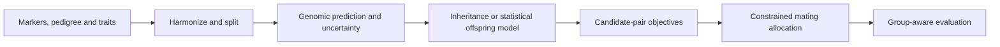

# Genomic Prediction and Crossbreeding Framework

I developed a Python research framework linking breeding ancestry, genomic prediction, inheritance simulation and constrained mating decisions. I implemented the model interfaces, simulation components, uncertainty checks, allocation logic and reproducible experiment runners.

Developed by [Vavan Farizzaman](https://github.com/VavanZaa).

## Algorithm

1. Prepare marker, pedigree and trait inputs with allele harmonization and training-fitted missing-value handling.
2. Compare ancestry baselines with additive GBLUP/ridge, additive-plus-dominance and nonlinear kernel models, tuning within training data.
3. Use group-aware evaluation and support/uncertainty diagnostics to expose extrapolation and population dependence.
4. Simulate meiosis on synthetic phased haplotypes using Haldane/Poisson crossover mechanics; keep statistical real-parent merit distributions as a separate path.
5. Estimate candidate-pair merit and trait trade-offs, then allocate matings under sire-capacity and genomic coancestry constraints.
6. Record seeds, configurations, cohort definitions and completion gates for repeatable experiments.

## Workflow



## Run

Commands below assume a Windows terminal at the repository root unless stated otherwise.

```powershell
python -m venv .venv
.venv\Scripts\python -m pip install -r requirements.txt
.venv\Scripts\python -m pytest -q
# Optional larger, explicitly synthetic A-F campaign:
.venv\Scripts\python scripts/run_all_stages.py
```

## Code map

`src/ancestry/`, `src/inheritance/`, `src/prediction/`, `src/decision/` and `src/evaluation/`: core framework; `scripts/`: runners and data adapters; `tests/`: synthetic checks; `docs/`: protocols.

## Scope and evidence

This is a research framework, not evidence that a biological breeding outcome improved. Predictions depend on traits, populations, data support and model assumptions. Large genotype records, downloaded studies and campaign output are excluded. External-data and R/AlphaSimR comparisons require their separately documented inputs and environments.

This is a focused source snapshot. Installed dependencies, local environments and bulk generated research assets are rebuilt or supplied separately. See [VALIDATION.md](VALIDATION.md) for the checks performed on this export and any remaining setup requirements.

## Optional research assets

The default source-only pytest profile skips checks that require excluded historical campaigns, generated indexes or empirical datasets. Their original assertions are retained. After restoring the matching assets, opt in with `python -m pytest --run-research-assets`. This flag does not download data or rerun a campaign automatically.
